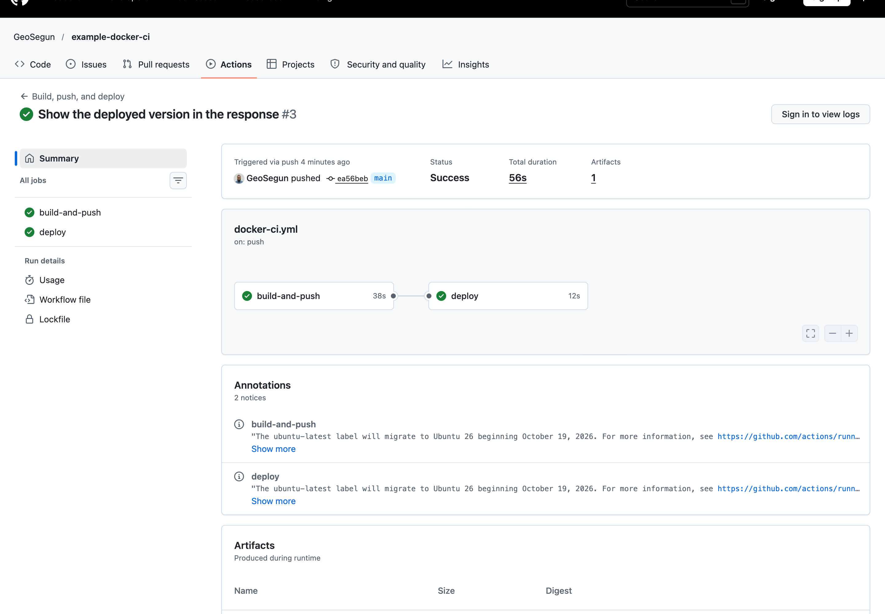

# Example: Docker CI/CD with GitHub Actions

A minimal FastAPI app that GitHub Actions tests, builds, and pushes to GitHub Container Registry, with an optional SSH deploy to a Linux server running Docker Compose.

Companion repo for the Seenode guide **How to Build, Push, and Deploy Docker Images With GitHub Actions**.

## Pipeline

On every push to `main`, pull request, or `v*` tag, the workflow:

1. Runs `python -m pytest -q`.
2. Builds a `linux/amd64` image.
3. Pushes it to `ghcr.io/<owner>/<repo>` with branch, PR, semver, and `sha-<commit>` tags.
4. On `main`, deploys the SHA tag over SSH when `ENABLE_VPS_DEPLOY=true`.

The build job uses the built-in `GITHUB_TOKEN`, so no PAT is needed to push.



## Run locally

```bash
docker build --platform linux/amd64 -t example-docker-ci:local .
docker run --rm -p 8000:8000 example-docker-ci:local
curl http://localhost:8000/health
```

## Deploy to a VPS (optional)

1. Create the repository variable `ENABLE_VPS_DEPLOY` with value `true`.
2. Add repository secrets `VPS_HOST`, `VPS_USER`, and `VPS_SSH_KEY`. Add `GHCR_READ_TOKEN` only if the package lives in another repository; same-repo deploys fall back to `GITHUB_TOKEN`.
3. Copy `docker-compose.yml` to `/opt/example-api` on the server, or change the `cd` path in the workflow.
4. Make sure `VPS_USER` can run `docker compose` without `sudo`.

The compose file maps host port `8080` to container port `8000` and pins `IMAGE_TAG`. To roll back, rerun with an older SHA.

## Registry and Seenode notes

Packages are private by default. An external server or Seenode needs a `read:packages` PAT; make the package public to skip credentials.

To run the image on [Seenode](https://seenode.com), create an app, choose **Docker image**, enter `ghcr.io/geosegun/example-docker-ci`, and set the port to `8000`. Image-backed apps do not redeploy on push; select the new tag and deploy. See the [Docker image docs](https://seenode.com/docs/services/docker-image) and [registry credentials](https://seenode.com/docs/configure/container-registry-credentials).
